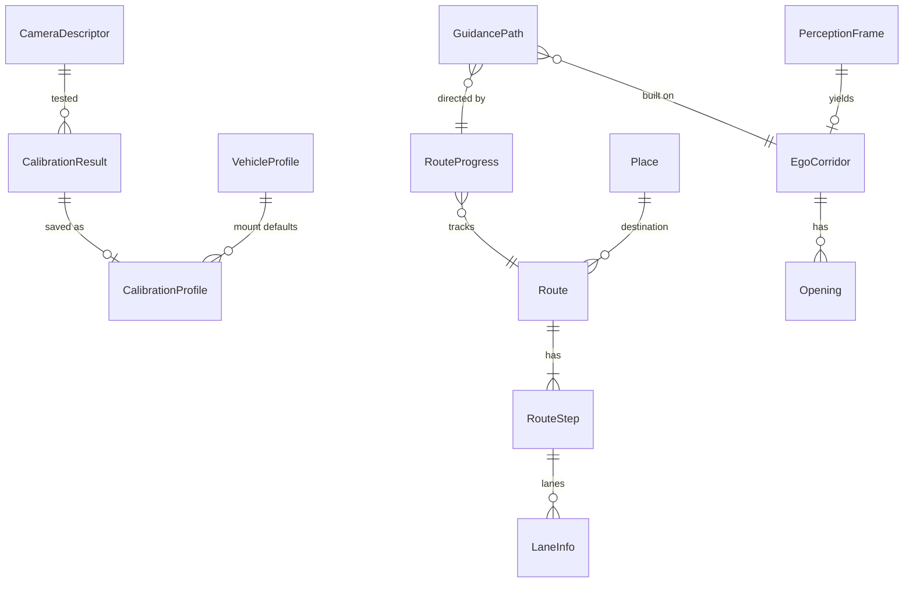

# Data Model: AR Road Navigation POC

**Feature**: `001-ar-road-navigation-poc` | **Spec**: [spec.md](./spec.md) | **Plan**: [plan.md](./plan.md)

Conventions: SI units (metres, seconds, radians internally; degrees only in UI/config). Timestamps `monotonicNanos: Long` (SystemClock.elapsedRealtimeNanos). Coordinates: WGS84 `LatLng` for geography; **vehicle frame** for the road plane: origin at the camera's ground projection, `x` right (+) / left (−), `z` forward. Persisted entities are marked 💾.

---

## 1. Device, camera & calibration

### CameraDescriptor
| Field | Type | Notes |
|-------|------|-------|
| index | Int | 1-based display index ("Camera 1") |
| cameraId | String | Camera2 id (logical) |
| physicalId | String? | Physical lens id, when addressed via a logical camera |
| label | enum {ULTRA_WIDE, MAIN, TELE, UNKNOWN} | Inferred from focal length rank + FOV |
| focalLengthMm | Float | |
| sensorSizeMm | SizeF | |
| hFovDeg / vFovDeg | Float | Derived |
| supportedProcessingSizes | List<Size> | YUV sizes ≥ 640×360 |
| maxSustainedFps | Int | From stream config map |
| hasPublishedIntrinsics | Boolean | `LENS_INTRINSIC_CALIBRATION` present |
| canLockLens | Boolean | Physical stream openable or zoom-ratio lock reliable |

### CalibrationCheck
| Field | Type | Notes |
|-------|------|-------|
| kind | enum {ORIENTATION, VIBRATION, SHARPNESS, NOISE, FPS, LATENCY, ROAD_VISIBILITY, DISTORTION} | |
| value | Float | Raw metric |
| score | Int 0–100 | Normalised |
| verdict | enum {PASS, WARN, FAIL} | |
| hint | String (res id) | Fix-it message |

### CalibrationResult
| Field | Type |
|-------|------|
| camera | CameraDescriptor |
| checks | List<CalibrationCheck> |
| overallScore | Int 0–100 |
| recommended | Boolean |
| timestamp | Instant |

### CalibrationProfile 💾
| Field | Type | Validation |
|-------|------|-----------|
| id | UUID | |
| deviceModel | String | `Build.MANUFACTURER + MODEL` |
| cameraId / physicalId | String / String? | Must exist on the device at load |
| processingSize | Size | |
| intrinsics | fx, fy, cx, cy (px at processing size) | fx, fy > 0 |
| distortion | k1, k2, k3, p1, p2 | Optional |
| mountType | enum {HANDLEBAR, DASHBOARD, WINDSHIELD} | |
| cameraHeightM | Float | 0.6–2.0 |
| pitchRad / rollRad | Float | \|roll\| ≤ 5° at save |
| yawOffsetRad | Float | Learned; default 0 |
| score | Int | |
| createdAt / lastVerifiedAt | Instant | |

### VehicleProfile 💾
| Field | Type | Default |
|-------|------|---------|
| type | enum {TWO_WHEELER, CAR} | TWO_WHEELER |
| mount | enum | HANDLEBAR (2W) / DASHBOARD (car) |
| cameraHeightM | Float | 1.1 (2W) / 1.2 (car) |
| minTurnRadiusM | Float | 4 (2W) / 6 (car) |
| widthM | Float | 0.8 (2W) / 1.7 (car) |

---

## 2. Places & routing

### Place
| Field | Type | Notes |
|-------|------|-------|
| placeId | String | Provider id (storable) |
| title / subtitle | String | |
| latLng | LatLng? | Transient; not persisted beyond the trip |

### RecentDestination 💾 — `placeId`, `title`, `subtitle`, `lastUsedAt`. Max 20, LRU.

### Route
| Field | Type |
|-------|------|
| routeId | String |
| travelMode | enum {TWO_WHEELER, DRIVE} |
| polyline | List<LatLng> (trip-scoped) |
| distanceM / durationS | Int |
| steps | List<RouteStep> |
| summary | String (via roads) |

### RouteStep
| Field | Type | Notes |
|-------|------|-------|
| index | Int | |
| maneuver | Maneuver | See enum |
| roadName | String? | |
| exitBearingDeg | Float? | Bearing of the outgoing segment at the manoeuvre point |
| entryBearingDeg | Float? | |
| lanes | List<LaneInfo>? | When the provider supplies them |
| roundaboutExit | Int? | |
| distanceFromStartM | Int | |

### Maneuver (enum)
`DEPART, STRAIGHT, TURN_SLIGHT_LEFT, TURN_LEFT, TURN_SHARP_LEFT, TURN_SLIGHT_RIGHT, TURN_RIGHT, TURN_SHARP_RIGHT, UTURN_LEFT, UTURN_RIGHT, FORK_LEFT, FORK_RIGHT, RAMP_LEFT, RAMP_RIGHT, MERGE, KEEP_LEFT, KEEP_RIGHT, ROUNDABOUT_CLOCKWISE, ROUNDABOUT_COUNTERCLOCKWISE, DESTINATION, UNKNOWN`

(In India U-turns are made to the right; adapters map provider variants accordingly.)

### LaneInfo
| Field | Type |
|-------|------|
| indexFromLeft | Int |
| allowedDirections | Set<LaneDirection> {LEFT, SLIGHT_LEFT, STRAIGHT, SLIGHT_RIGHT, RIGHT, UTURN} |
| recommended | Boolean |

### RouteProgress (stream, ≥ 1 Hz)
| Field | Type | Notes |
|-------|------|-------|
| t | monotonicNanos | |
| snappedLatLng | LatLng | |
| positionAccuracyM | Float | |
| distanceAlongRouteM | Float | |
| currentStepIndex | Int | |
| nextManeuver | RouteStep? | |
| distanceToManeuverM | Float | |
| remainingDistanceM / remainingTimeS | Int | |
| speedLimitKph | Int? | |
| state | enum {NAVIGATING, OFF_ROUTE, REROUTING, ARRIVED, GPS_LOST} | |
| lookAheadLatLng | LatLng | Point 50–150 m ahead on the route (for the pointer) |

---

## 3. Sensors & pose

### PoseSample
| Field | Type |
|-------|------|
| t | monotonicNanos |
| gravity | Vec3 (device frame) |
| rotationQuat | Quat (device→world) |
| gyro | Vec3 rad/s |
| pitchRad / rollRad | Float (camera relative to road) |
| headingRad | Float (vehicle, true north) |
| headingSource | enum {COURSE_OVER_GROUND, ROTATION_VECTOR, FUSED} |
| speedMps / speedAccuracyMps | Float |
| relAltitudeM | Float? (barometer, trip-relative) |
| vibrationRms | Float |

### CameraPose (derived per frame)
`K`, `distortion`, `height`, `pitch`, `roll`, `H` (3×3 ground homography), `Hinv`, `validRangeM [4, 60]`.

---

## 4. Perception

### PerceptionFrame
| Field | Type | Notes |
|-------|------|-------|
| frameT | monotonicNanos | Capture timestamp |
| inferenceMs | Float | |
| classMask | ByteArray W×H (e.g., 160×90 or 320×180) | Class ids per R-04 |
| classConfidence | ByteArray W×H | Max-softmax 0–255 |
| bev | BevGrid | |
| lanes | List<LaneLine> | |
| egoCorridor | EgoCorridor? | |
| occluderMask | ByteArray | Vehicle/person/animal/barrier |
| visibleRoadRatio | Float | |
| quality | enum {OK, LOW_LIGHT, BLUR, OBSTRUCTED} | |

### BevGrid
`cellM = 0.25`, `width = 128` (±16 m), `depth = 256` (0–64 m), `cells: ByteArray` (class), `conf: ByteArray`.

### LaneLine
`points: List<Vec2>` (vehicle frame), `type: {DASHED, SOLID, DOUBLE_SOLID, UNKNOWN}`, `colour: {WHITE, YELLOW, UNKNOWN}`, `confidence`.

### EgoCorridor
| Field | Type | Notes |
|-------|------|-------|
| rule | enum {MEDIAN, CENTRE_LINE, LEFT_PORTION, FULL_NARROW, LANE} | Which R-07 rule applied |
| leftEdge / rightEdge | List<Vec2> | Per 0.5 m row |
| centreline | Spline2 | |
| roadWidthM | Float | At 10–20 m |
| lanes | Int? / egoLaneIndex Int? | Lane 1 = left-most |
| ruleMargin | Float 0–1 | Clarity for confidence |
| openings | List<Opening> | Turn-side drivable gaps |

### Opening
`side: {LEFT, RIGHT}`, `startZ / endZ`, `widthM`, `bearingRad`, `confidence`.

### SignalDetection (stretch)
`trackId`, `bbox`, `estDistanceM`, `indications: List<{type: DISC|LEFT|STRAIGHT|RIGHT|UTURN, colour: RED|AMBER|GREEN|OFF, conf}>`, `flashing: Boolean`, `countdownS: Int?`, `associatedToEgo: Boolean`.

---

## 5. Guidance

### GuidancePath
| Field | Type | Notes |
|-------|------|-------|
| t | monotonicNanos | |
| kind | enum {CRUISE, APPROACH_TURN, IN_TURN, LANE_CHANGE, FORK, U_TURN, ROUNDABOUT} | |
| samples | List<PathSample> | Every 0.5 m from 4 m to ≤ 60 m |
| validatedRatio | Float | Share of samples in the drivable mask |
| branchLabel | String? | "Take flyover", "Service road (left)" |

### PathSample — `pos: Vec2`, `tangent: Vec2`, `curvature: Float`, `alpha: Float` (fade), `s: Float` (arc length).

### GuidanceStyle
`colour: {NEUTRAL, GREEN, AMBER, RED, HIGH_CONTRAST}`, `stopBarAtZ: Float?`, `opacityScale: Float`, `spacingM: Float`, `flowSpeedMps: Float`.

### GuidanceMode (state machine in plan.md)
`INITIALIZING, FULL_AR, STRAIGHT_ONLY_AR, FALLBACK, REROUTING, PAUSED, ARRIVED`

### HudState
`pointerAngleRad`, `maneuverGlyph`, `distanceToManeuverM`, `branchLabel?`, `speedKph?`, `speedOverLimit`, `etaMin`, `remainingKm`, `indicators: Set<{ROAD_VIEW_LIMITED, WEAK_GPS, REROUTING, THERMAL_REDUCED, RECORDING, PAUSED}>`, `signalCountdownS?`.

### LaneChangePlan
`fromLane`, `toLane`, `startZ`, `lengthM`, `status: {NOT_NEEDED, PLANNED, ACTIVE, TOO_LATE}`.

---

## 6. Settings & governance

### AppSettings 💾
`safetyNoticeAcceptedAt`, `providerTermsAcceptedAt`, `units = METRIC`, `highContrast`, `minimapEnabled`, `chimesEnabled`, `featureFlags`, `devMode`.

### ThermalLevel — `L0…L4` (R-13). `GovernorDecision`: `perceptionHz`, `processingSize`, `signalDetectorOn`, `minimapOn`, `displayFps`, `arAllowed`.

### TripLog (dev only) 💾
`video.mp4` (H.264, selected lens) + `sensors.jsonl` (PoseSample) + `nav.jsonl` (RouteProgress, events) + `meta.json` (device, profile, app version, model hash). Retained until deleted by the user; never uploaded automatically.

---

## 7. Relationships

