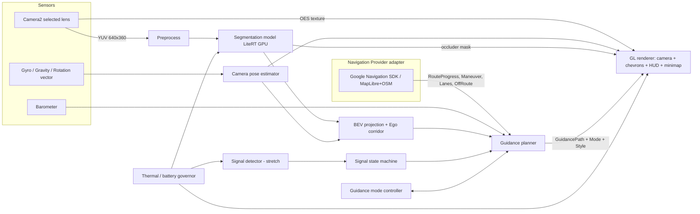
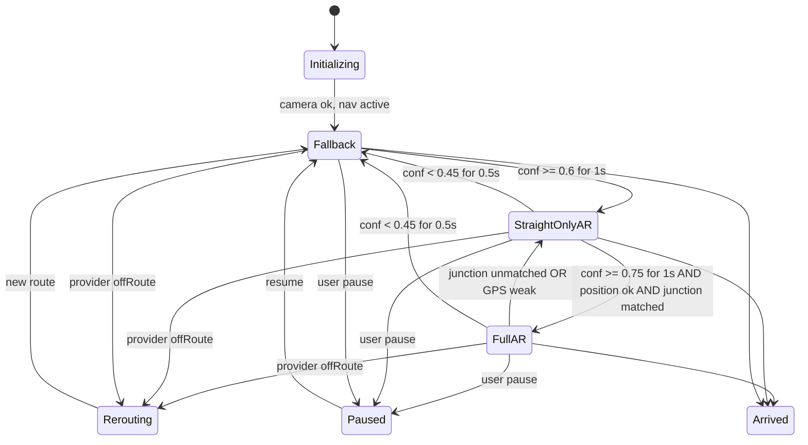
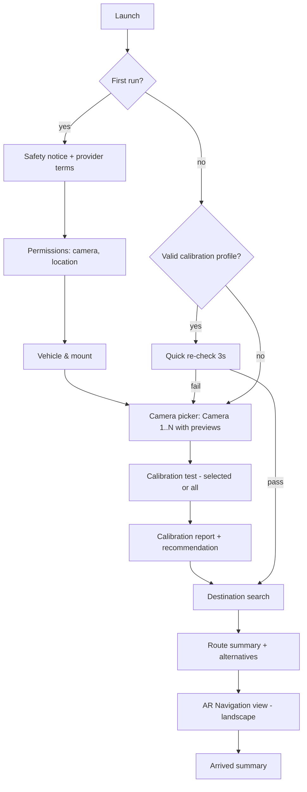

# Implementation Plan: AR Road Navigation POC

**Feature**: `001-ar-road-navigation-poc` | **Date**: 2026-11-22 | **Spec**: [spec.md](./spec.md) | **Research**: [research.md](./research.md)

## Summary

Build a native Android app that turns a horizontally mounted phone into a "glass" for AR navigation. The user picks and calibrates a rear lens. They choose a destination, and a navigation SDK (Google Navigation SDK within its free caps; MapLibre Navigation + OpenStreetMap as the free fallback) provides the route and live progress. An on-device segmentation model finds the user's own carriageway. A guidance planner fuses route intent (what/when) with perception (where) and produces smooth, curve-continuous paths. A single OpenGL ES pass then draws translucent chevrons on the road plane, with a top direction pointer, speed, ETA and an optional vector minimap. A confidence-driven mode controller degrades to a screen-fixed fallback arrow whenever the app is unsure.

## Technical Context

| Item | Value |
|------|-------|
| **Language/Version** | Kotlin 2.x (JDK 17 toolchain); GLSL ES 3.10; Python 3.11 for ML training/eval tooling |
| **Primary Dependencies** | AndroidX (Core, Lifecycle, Activity, Compose BOM, DataStore), Camera2 (platform), LiteRT/TensorFlow Lite runtime + GPU delegate, Google Navigation SDK for Android (+ Places SDK/Places API New), MapLibre Navigation Android (free fallback adapter), Kotlin Coroutines/Flow, kotlinx.serialization. No OpenCV in the app (size); math in Kotlin + GLSL. *Dev infra (free):* self-hosted GraphHopper or Valhalla with the Karnataka OSM extract for the fallback adapter |
| **Storage** | Jetpack DataStore (proto/JSON) for settings, calibration profiles, recent destinations. App-private files for dev recordings |
| **Testing** | JUnit5 + Truth/kotest assertions (pure Kotlin modules), Robolectric where needed, Compose UI tests, AndroidX Benchmark/Macrobenchmark, on-device replay test runner, Python pytest for model eval |
| **Target Platform** | Android 10+ (API 29), arm64-v8a, OpenGL ES 3.1+, landscape |
| **Project Type** | Mobile app (multi-module Gradle) + ML tooling folder |
| **Performance Goals** | See *Budgets* below (NFR-001…NFR-007) |
| **Constraints** | On-device perception only; ≤ 50 MB download; mount-only usage; no interaction while moving |
| **Scale/Scope** | POC: ~8 screens, 1 AR view, 1–2 models, 2 reference devices, Bengaluru evaluation routes |

## Constitution Check

| Principle | How this plan complies | Status |
|-----------|-----------------------|--------|
| I.1–I.2 Eyes on road, no occlusion | Opacity/coverage caps, keep-clear zones, occluder masking (R-09) | ✅ |
| I.3 Fail safe | `GuidanceModeController` with confidence + hysteresis; fallback arrow (US4) | ✅ |
| I.4 Advisory only | No "safe" wording; uncertain signal ≠ green (R-11) | ✅ |
| I.5 No interaction while moving | `MotionLock` gate on all inputs except Pause/End/Mute/Recenter | ✅ |
| I.6 Left-hand traffic, ego side only | Ego-carriageway rules (R-07); never-draw zones | ✅ |
| II Lightweight/fast | Native + GLES; one segmentation model; budgets; thermal ladder | ✅ |
| III Privacy | Frames never leave device; dev recording opt-in; keys restricted | ✅ |
| IV Provider independence | `NavigationProvider`, `PerceptionEngine`, `MapRenderer` contracts | ✅ |
| V Testable | Replay harness, evaluation set, requirement→test matrix | ✅ |
| VI Honest evidence | Evidence labelled bench/replay/field/not-verified in quickstart | ✅ |
| VII Incremental | MVP = US1–US4; stretch features feature-flagged | ✅ |
| Licensing constraint | Licence register task (T006) before any model ships | ⚠️ Pending: dataset/model licences to be confirmed |
| Zero-cost POC (NFR-014) | Google free caps + Cloud quotas + budget alert + in-app usage guard; OSM fallback; tests use `nav:fake` | ✅ |

## Architecture

### Component view



### Threads & data flow

| Thread | Work | Rate |
|--------|------|------|
| Camera HAL callback | Delivers OES frames + YUV images | 30 fps |
| `perception` (single, high priority) | Preprocess → inference → postprocess (BEV, ego corridor) | 15–30 Hz (drop stale) |
| `signal` (stretch) | Upper-crop detection + classification | 5–10 Hz |
| `guidance` (coroutine, Default dispatcher) | Fuse latest perception + provider progress → path, mode, style | On each perception result and nav update |
| `render` (GL thread) | Draw camera + overlay with IMU late warp; HUD | Display rate (30/60) |
| Main | UI (Compose screens), provider callbacks | — |

All messages carry `monotonicNanos` timestamps (FR-032). Queues are single-slot "latest wins".

### Per-frame budgets (engineering budgets, mid-range reference; designed to hit the NFR *targets*, which leaves headroom for the POC gates)

| Stage | Budget |
|-------|--------|
| YUV → RGB tensor (GPU or libyuv-style NEON) | ≤ 3 ms |
| Segmentation inference (GPU FP16) | ≤ 15 ms |
| Postprocess: BEV warp (128×256), components, ego corridor, spline fit | ≤ 5 ms |
| Guidance planning | ≤ 2 ms |
| GL render (camera quad + ≤ 40 chevron instances + HUD) | ≤ 6 ms GPU |
| Motion-to-photon (sensor → display) | ≤ 100 ms p95 |

### Guidance mode controller (state machine)



Thresholds are tunable defaults in a single `GuidanceConfig` and are tuned with replay data. They are not acceptance criteria (spec → Acceptance policy).

**Confidence score** (0–1) = weighted min/mean of: segmentation mean max-softmax in the ego corridor (0.35), ego-corridor clarity (rule margin, 0.2), visible road area ratio (0.15), pose stability (vibration/roll, 0.1), position accuracy (0.1), route-vs-perception agreement (0.1). Any hard veto forces Fallback: roll > 15°, camera stalled > 300 ms, thermal L3+.

## Screen flow



## AR view layout (landscape, POC "glass")

```
+------------------------------------------------------------------------+
|  [ETA 18 min · 6.2 km]      [ ⟳ POINTER  ↱ 300 m ]        [status ●●] |  ← top band ≤ 15% height
|                              "Take flyover"                            |
|                                                                        |
|                    (live camera view, road ahead)                      |
|                                                                        |
|                 ›››  translucent chevrons on ego carriageway  ›››      |
|                                                                        |
| ( minimap )                                                 [ 42 ]     |
| (  ↑ route )                                                 km/h     |
|  [ PAUSE ]                  (keep-clear bottom 12%)          [ END ]   |
+------------------------------------------------------------------------+
```

- Pointer: 64–96 dp arrow, rotates by `bearingToLookAhead − vehicleHeading` and is smoothed (critically damped spring, ~250 ms). Manoeuvre glyph + distance to its right.
- Speed: bottom-right, 40 sp digits; amber when > speed limit (if known).
- Minimap: bottom-left circle (diameter ≈ 22% of screen height), 70% opacity, heading-up.
- Status dots: road-view, GPS, thermal, recording (dev).

## Project Structure

### Documentation (this feature)

```
Specs/001-ar-road-navigation-poc/
├── spec.md
├── research.md
├── plan.md              # this file
├── data-model.md
├── quickstart.md
├── contracts/
│   ├── navigation-provider.md
│   ├── camera-and-calibration.md
│   ├── perception-engine.md
│   └── guidance-and-rendering.md
├── checklists/requirements.md
└── tasks.md
```

### Source Code (repository root — to be created)

```
limitless-sight/
├── app/                          # Application, DI wiring, Compose nav graph, AR Activity (landscape)
├── core/
│   ├── common/                   # Clock, Result types, logging, feature flags, GuidanceConfig
│   ├── geometry/                 # Pure Kotlin: intrinsics, homography, BEV, splines, Bezier/clothoid, filters
│   └── designsystem/             # Compose theme, HUD colours, typography
├── feature/
│   ├── onboarding/               # Safety notice, terms, permissions, vehicle & mount
│   ├── camera/                   # Camera2 enumeration, session controller, lens lock
│   ├── calibration/              # Checks, scoring, profile store, quick re-check
│   ├── destination/              # Search UI, recents, route summary
│   └── navigation/               # AR navigation screen host, MotionLock, controls
├── nav/
│   ├── api/                      # NavigationProvider contract + models (no SDK deps)
│   ├── google/                   # Google Navigation SDK + Places adapter
│   ├── osm/                      # MapLibre Navigation + GraphHopper/Valhalla adapter (free fallback)
│   ├── usage/                    # Free-cap usage guard (FR-025): per-SKU monthly counters
│   └── fake/                     # Scripted/replay provider for tests
├── perception/
│   ├── api/                      # PerceptionEngine contract, PerceptionFrame
│   ├── litert/                   # LiteRT segmentation + (stretch) signal detector
│   └── postprocess/              # Pure Kotlin: BEV mask, components, ego corridor, lanes
├── guidance/                     # Pure Kotlin: planner, lane-change, U-turn, mode controller, signal FSM
├── render/                       # GLES renderer, shaders, chevron SDF, HUD, vector minimap
├── platform/
│   ├── sensors/                  # IMU pose, heading, barometer, speed
│   └── governor/                 # Thermal & battery ladder
├── replay/                       # Recorder (dev) + player feeding camera/sensor/nav fakes
├── benchmark/                    # Macrobenchmark + frame timing
└── ml/                           # Python: training, export to .tflite, evaluation, licence register
    ├── datasets/  (manifests only)
    ├── train/
    ├── export/
    └── eval/
```

**Structure decision**: multi-module Android project. Pure-Kotlin modules (`core:geometry`, `perception:postprocess`, `guidance`, `nav:api`) have no Android dependencies, so the safety-critical logic is unit-testable on the JVM and reusable for the future glass target.

## Key design details

### Calibration pipeline (US1)
1. `CameraEnumerator` → `List<CameraDescriptor>` (logical + physical lenses).
2. For each lens under test: open a session at the processing size; run checks in parallel for ~8 s. `CalibrationScorer` produces `CalibrationResult`.
3. Pitch/roll from gravity; horizon from segmentation (road top boundary) and/or vanishing point. Yaw offset is estimated during the first 20 s of straight driving (heading vs COG) and stored.
4. Persist a `CalibrationProfile` keyed by (deviceModel, cameraId, mountType).

### Route sync (FR-030/031)
- `NavigationProvider.progress: Flow<RouteProgress>` at ≥ 1 Hz. Interpolated to render rate via speed × dt along the route.
- Vehicle frame: origin at the camera's ground projection, z forward along the vehicle heading.

### Junction matching (R-05)
- Predicted junction distance d̂ = distanceToManeuver − (camera ground offset). Search window = d̂ ± max(8 m, 2σ_position).
- Openings = runs of drivable cells beyond the ego corridor's turn-side edge with width ≥ 3 m (two-wheeler) / 4 m (car). Choose the opening whose bearing best matches the exit bearing (≤ 35° error).

### Lane-change planner (US6)
- Inputs: lanes (count, ego index), recommended lanes (provider) or turn side, distance to manoeuvre, speed.
- Output: target lane index, start distance, S-curve parameters, or `NoPromptTooLate`.

### Signal colouring (US7) — feature flag `signal_colouring` (default OFF)
- Detector runs only when the next manoeuvre point is ≤ 150 m and thermal ≤ L1.

### Configuration & flags
- `GuidanceConfig` (thresholds), `FeatureFlags` (signal_colouring, minimap, provider_map_minimap, dev_recording, replay_mode). Local only; no remote config in the POC.

### Security & secrets
- API keys via the Gradle secrets plugin from `local.properties` (git-ignored). Keys are restricted to the Android package + SHA-1 in Google Cloud. CI uses an injected secret.
- No analytics SDKs in the POC. Crash reporting only with explicit opt-in (dev builds).

## Rollout, disable and recovery

| Stage | Who | Exit evidence |
|-------|-----|---------------|
| Bench (desk) | Devs | Unit + replay green, budgets measured |
| Parking-lot / closed road | Dev + safety operator | Calibration, overlay alignment, fallback behaviour |
| Supervised field (Bengaluru routes) | Rider/driver + passenger operator | SC-001…SC-010 evidence pack |
| Internal pilot (≤ 20 users) | Product | Crash-free, usability feedback |

**Kill-switches**: feature flags for every stretch feature. "AR off" setting → HUD + fallback arrow only. Uninstall removes all local data.

## Complexity Tracking

| Item | Why needed | Simpler alternative rejected because |
|------|-----------|--------------------------------------|
| Custom GLES renderer (vs Compose Canvas overlay) | Single-pass camera + overlay with late warp and mask sampling meets the latency budget | Compose/Canvas overlay adds a compositor layer and CPU drawing; jitter and latency |
| Camera2 (vs CameraX) | Physical-lens selection, focus/exposure/stabilisation control | CameraX hides some per-physical-camera controls |
| Two navigation adapters | Keeps the POC free and unblocked: Google within free caps, plus a no-cost OSM fallback | Single-vendor dependency blocks the POC if the free cap is reached or billing can't be enabled |
| Separate signal detector | Signal heads are small and far; the segmentation resolution is too low | Segmentation-only cannot classify arrow signals |
