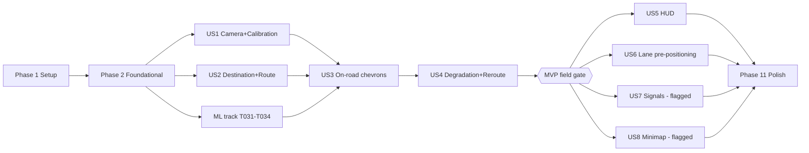

# Tasks: AR Road Navigation POC

**Feature**: `001-ar-road-navigation-poc` | **Input**: [spec.md](./spec.md), [plan.md](./plan.md), [research.md](./research.md), [data-model.md](./data-model.md), [contracts/](./contracts/)

**Format**: `- [ ] Txxx [P?] [Story?] Description (path)`
- **[P]** = can run in parallel (different files, no dependency on unfinished tasks)
- **[USn]** = user story from spec.md
- Paths are relative to the future source root `limitless-sight/` (see plan.md → Project Structure)
- Every task is **done when** its stated check passes. Tests are written before or with the implementation for pure-Kotlin modules.

---

## Phase 1: Setup (shared infrastructure)

- [ ] T001 Create the multi-module Gradle project per plan (app, core/*, feature/*, nav/*, perception/*, guidance, render, platform/*, replay, benchmark) with Kotlin 2.x, JDK 17, minSdk 29, arm64-only (`settings.gradle.kts`, `build-logic/`). *Done when* `./gradlew assembleDebug` succeeds with empty modules.
- [ ] T002 [P] Configure lint, ktlint/detekt, and a string-resource lint rule that rejects safety-asserting phrases ("safe to", "clear to go", "lane clear") (`build-logic/`, `config/detekt.yml`). *Done when* a seeded bad string fails the build. (FR-055, G11)
- [ ] T003 [P] Secrets setup via the Gradle secrets plugin reading `local.properties`. Add `.gitignore` entries. *Done when* the key is read in debug builds and absent from VCS.
- [ ] T004 [P] CI workflow: build, unit tests, lint on every PR (`.github/workflows/android.yml`).
- [ ] T005 [P] Create `ml/` scaffold: `requirements.txt` (pinned), `train/`, `export/`, `eval/`, `datasets/manifest.yaml`.
- [ ] T006 [P] Create the licence register for SDKs, models and datasets (`ml/LICENSES.md`). *Done when* each candidate (IDD, BDD100K, model repos, Nav SDKs) has licence + commercial-use status recorded.

---

## Phase 2: Foundational (blocks all user stories)

- [ ] T010 [P] `core:common`: `MonotonicClock`, `Result`/error types, logging facade, `FeatureFlags`, `GuidanceConfig` (all thresholds from spec/research as config) (`core/common/src/main/...`).
- [ ] T011 [P] `core:geometry`: Vec2/3, Mat3, Quat, intrinsics scaling, ground homography H/H⁻¹, BEV mapping, smoothing spline, cubic Bézier/clothoid approximations, critically damped spring + unit tests (`core/geometry/src/{main,test}`). *Done when* round-trip pixel→ground→pixel error < 0.5 px on synthetic cameras.
- [ ] T012 [P] `nav:api`: `NavigationProvider`, models (`Place`, `Route`, `RouteStep`, `Maneuver`, `LaneInfo`, `RouteProgress`, `NavEvent`), typed errors (contracts/navigation-provider.md).
- [ ] T013 [P] `nav:fake`: scripted provider (straight, left, right, fork/flyover, U-turn, roundabout, off-route, GPS loss, arrival) + `nav:api` contract test suite run against the fake.
- [ ] T014 [P] `perception:api`: `PerceptionEngine`, `PerceptionFrame`, `BevGrid`, `LaneLine`, `EgoCorridor`, `Opening`, `ModelInfo`.
- [ ] T015 [P] `platform:sensors`: gravity/rotation/gyro/barometer listeners, `PoseSample` stream, heading fusion (COG vs rotation vector), speed smoothing (research R-10) + unit tests for fusion logic.
- [ ] T016 [P] `platform:governor`: thermal listener + headroom, battery level, `GovernorDecision` ladder L0–L4 (research R-13) + unit tests.
- [ ] T017 `replay`: TripLog format (`video.mp4`, `sensors.jsonl`, `nav.jsonl`, `meta.json`), recorder (dev mode, indicator) and player that drives camera/sensor/nav fakes with original timing (FR-100, FR-101). Depends on T012, T015.
- [ ] T018 [P] `core:designsystem`: Compose theme, HUD colour tokens (neutral, high-contrast, signal colours), typography ≥ 18 sp HUD.
- [ ] T019 App shell: single-activity Compose nav graph, landscape lock on AR route, keep-screen-on, `MotionLock` (blocks inputs > 5 km/h except Pause/End/Mute/Recenter) (FR-004, FR-023). Depends on T015.

**Checkpoint**: foundation ready. User stories can start.

---

## Phase 3: User Story 1 — Choose a camera and calibrate it (P1) 🎯 MVP

**Goal**: list all rear lenses, calibrate, recommend the best, persist the profile.
**Independent test**: spec US1 Independent Test.

- [ ] T020 [P] [US1] Onboarding screens: safety notice, provider terms hook, permissions rationale (camera, precise location), vehicle & mount picker with height defaults (FR-001…FR-003) (`feature/onboarding`).
- [ ] T021 [P] [US1] `CameraEnumerator` incl. physical lenses, FOV, label inference, `canLockLens` (C1, C2) + unit tests for label/FOV (`feature/camera`).
- [ ] T022 [US1] `CameraSessionController`: Camera2 session with OES preview + YUV `ImageReader`, locked focus/exposure cap/no EIS, sensor→monotonic timestamping, `CameraStats` (C3, FR-016). Depends on T021.
- [ ] T023 [P] [US1] Device quirk table + loader (`feature/camera/quirks.json`).
- [ ] T024 [US1] Calibration checks: orientation/level, vibration, sharpness, noise, fps, latency (uses perception warm-up), road visibility/horizon, distortion (research R-03 table). Depends on T022, T015, T031 (latency + road visibility need the model; use a stub model until T031 lands).
- [ ] T025 [P] [US1] `CalibrationScorer` with configurable weights + unit tests (C5).
- [ ] T026 [US1] Camera picker UI: "Camera 1…N" cards with live thumbnail, label, FOV. "Calibrate" and "Test all cameras" (sequential with cool-down, C6).
- [ ] T027 [US1] Calibration report UI: per-check pass/warn/fail + hints, recommendation sentence (C9), override with warning.
- [ ] T028 [P] [US1] `CalibrationRepository` (DataStore) + profile validation. Yaw-offset learning hook (first 20 s of straight driving).
- [ ] T029 [US1] `QuickRecheck` (≤ 3 s, ±3°) on navigation start (FR-015).
- [ ] T030 [US1] Instrumented test: enumeration snapshot on reference devices + 10-minute lens-lock test.

---

## Phase 4: User Story 2 — Destination & best route (P1) 🎯 MVP

**Goal**: Bengaluru-biased search, best route for the vehicle, start guidance.

- [ ] T035 [P] [US2] `nav:google` adapter: terms dialog, Places autocomplete with Bengaluru bias + `IN` restriction, session tokens and debounce (N12), route computation (two-wheeler/drive), guidance start/stop, progress + events mapping, manoeuvre & lane mapping (N1–N13).
- [ ] T034a [P] [US2] Free-cap setup (one-time, ops): Cloud Console per-API daily quotas below the free caps, budget alert at ₹1, pricing page check date recorded in the spec Decision log (NFR-014). *Done when* quota screenshots are saved in `evidence/sc-007/`.
- [ ] T036a [P] [US2] `nav:usage` `UsageGuard` decorator: persisted per-SKU monthly counters, limit = 80% of free cap (config), `FreeCapReached` → offer the OSM provider or show the limit message (FR-025, N11, N13) + unit tests (rollover, limit, no billable call after the limit).
- [ ] T036 [P] [US2] Destination search UI: current-location source, suggestions (name/locality/distance), offline message, recents (max 20, clearable) (FR-020, FR-024).
- [ ] T037 [US2] Route summary UI: distance/ETA/via, alternatives (stationary only), two-wheeler fallback note (FR-021, FR-022).
- [ ] T038 [US2] Compose UI tests with `nav:fake` for search → summary → start, and MotionLock blocking when moving (FR-023).
- [ ] T039 [P] [US2] `nav:osm` free fallback adapter: MapLibre Navigation Android + self-hosted GraphHopper/Valhalla routing + Photon search, OSM attribution, capability flags (no traffic, sparse lanes). Docker compose for the local routing stack (`infra/osm/`). *Done when* the `nav:api` contract suite passes against a local server and a BLR-07 route is navigable on device.

---

## Phase 5: User Story 3 — On-road chevrons on own carriageway (P1) 🎯 MVP core

**Goal**: perception → ego corridor → smooth path → chevrons on the road plane.

### ML track
- [ ] T031 [P] [US3] Benchmark candidate segmentation models (TwinLiteNet-style, PP-LiteSeg-T, DeepLabV3+ MobileNetV3) on reference devices (latency) and IDD/our data (accuracy). Write the selection report (`ml/eval/model-selection.md`).
- [ ] T032 [US3] Train/fine-tune the selected model on IDD + Bengaluru captures with the 9-class schema. Export `.tflite` FP16 (+ INT8 trial) with metadata (`ml/train`, `ml/export`). Depends on T031, T006, T034.
- [ ] T033 [P] [US3] Offline eval scripts: mIoU, ego-corridor IoU, leakage metric SC-001 (`ml/eval`).
- [ ] T034 [P] [US3] Data capture & labelling pipeline: CVAT schema, blur faces/plates, dataset manifest `blr-seg-eval-v1` (research R-15). Depends on T017 for recording.

### App track
- [ ] T040 [US3] `perception:litert`: LiteRT GPU delegate engine, preprocessing (YUV→RGB resize), single-slot queue, capture-timestamped results (P1), `setRate` + on-device latency benchmark. Depends on T014, T022.
- [ ] T041 [P] [US3] `perception:postprocess`: BEV warp of mask, connected components, lane-line extraction, quality flags (P5–P7) + unit tests.
- [ ] T042 [US3] `EgoCorridorEstimator` implementing R-07 precedence and P3/P4 + golden synthetic tests (divided, centre line, wide undivided, narrow, footpath adjacent, bus occluding). Depends on T041.
- [ ] T043 [US3] Junction/opening detection + matching against route manoeuvre (plan "Junction matching") + unit tests. Depends on T042, T012.
- [ ] T044 [US3] `GuidancePlanner` cruise/turn/fork/U-turn/roundabout path generation with G1–G6 + table-driven tests. Depends on T011, T043.
- [ ] T045 [US3] `render`: GL surface, camera OES quad (+ undistortion), instanced SDF chevrons on the road plane via H, mask clip + occluder discard, opacity/spacing/flow/fade, coverage cap, keep-clear (R1–R5). Depends on T011.
- [ ] T046 [US3] IMU late-warp between the perception frame and the displayed frame (R2) + jitter filter (FR-047). Depends on T045, T015.
- [ ] T047 [US3] Navigation screen host wiring: camera → perception → guidance → renderer; Pause/End controls (FR-054). Depends on T040, T044, T046, T035.
- [ ] T048 [US3] Offscreen GL golden-image tests for chevron placement with fixed H and masks.
- [ ] T049 [US3] Replay test: SC-001 leakage + SC-010 jitter on `blr-replay-v1`, report in `evidence/`.

---

## Phase 6: User Story 4 — Safe degradation & rerouting (P1) 🎯 MVP

- [ ] T050 [US4] Confidence score computation (plan) + `GuidanceModeController` FSM with hysteresis and vetoes (roll > 15°, camera stall, thermal L3) + unit tests for every transition. Depends on T044.
- [ ] T051 [US4] Fallback arrow rendering + status indicators (road view limited, weak GPS, rerouting, thermal reduced, paused, recording) (FR-051, R6).
- [ ] T052 [US4] Off-route/reroute handling from provider events; suppress manoeuvre curves under weak GPS (> 25 m) (US4-3/4, FR-052).
- [ ] T053 [US4] Governor integration: apply perception rate/size, signal detector, minimap and display fps per ladder; L3 → fallback (FR-053). Depends on T016, T040.
- [ ] T054 [US4] Lifecycle: background/foreground, calls, camera failure → fallback with message (E12, US4-6).
- [ ] T055 [US4] Fault-injection replay suite for SC-006 (perception loss, GPS loss, off-route, thermal, camera stall).

**Checkpoint — MVP**: US1–US4 demonstrable end-to-end in replay and on a closed road. Run the field gate (quickstart §7) before Phase 7+.

---

## Phase 7: User Story 5 — Direction pointer, distance, speed HUD (P2)

- [ ] T060 [P] [US5] Pointer angle computation (G9) with look-ahead and spring smoothing + unit tests (wrap-around, reverse heading).
- [ ] T061 [US5] HUD rendering: pointer, manoeuvre glyph set (incl. fork/ramp/U-turn/roundabout exit n), distance formatting, branch label, ETA/remaining, speed with accuracy gating and amber over-limit (FR-060…FR-063, G10, R7).
- [ ] T062 [US5] Sunlight/high-contrast mode + field readability check (NFR-013).

## Phase 8: User Story 6 — Lane pre-positioning (P2)

- [ ] T065 [US6] Lane model from lane lines (count, ego index; lane 1 = left-most) with temporal stability. Depends on T041.
- [ ] T066 [US6] `LaneChangePlanner` (G7): provider recommended lanes or turn-side rules, S-curve, TOO_LATE suppression, free-left slip lane preference + table tests.
- [ ] T067 [US6] Render lane-change cue + S-curve path. Replay test SC-009a (zero late cues) and SC-009b (timing) on BLR-04 logs.

## Phase 9: User Story 7 — Signal-aware colouring (P3, OPTIONAL for POC, flagged OFF)

> Product owner decision (2026-11-22): nice to have, not mandatory. Do this phase only if time allows after the MVP field gate. It isn't part of POC acceptance, and skipping it blocks nothing.

- [ ] T070 [P] [US7] Signal dataset `blr-signal-v1` capture/labelling (per-movement state, free-left flags).
- [ ] T071 [US7] Train/export detector + state classifier (licence-clean). Offline eval incl. false-green (SC-008).
- [ ] T072 [US7] `SignalPerception` on-device (upper crop, 5–10 Hz, tracker, association P8/R-11).
- [ ] T073 [US7] Signal state FSM with temporal vote, movement mapping, free-left handling. Colour + stop-bar rendering (G8, FR-082) + unit tests guaranteeing uncertain ≠ green.
- [ ] T074 [US7] Gate review: enable the flag only if SC-008 evidence passes. Record the decision in spec Decision log.

## Phase 10: User Story 8 — Minimap (P3, flagged)

- [ ] T080 [US8] Vector minimap in GL: heading-up, route polyline in vehicle frame, manoeuvre markers, speed-based zoom (R8). Default per vehicle type.
- [ ] T081 [US8] Stationary-only full-screen route overview on tap.
- [ ] T082 [US8] (Optional) provider map view in the circular viewport behind `provider_map_minimap` flag. Measure the SC-007 impact.

---

## Phase 11: Polish & cross-cutting

- [ ] T090 [P] Performance pass on both reference devices: Macrobenchmark startup, Perfetto frame timing, motion-to-photon measurement (high-speed camera filming phone + LED/IMU tap), 30-min thermal soak (gate) and 45-min soak (target), battery drain, network usage, Cloud billing report = ₹0. Report every NFR as gate pass/fail + measured value vs target (SC-007).
- [ ] T091 [P] APK size audit (≤ 50 MB), strip unused ABIs/resources, model quantisation decision (NFR-004).
- [ ] T092 [P] Accessibility: colour+shape redundancy audit, text sizes, TalkBack labels on non-AR screens (NFR-012).
- [ ] T093 [P] Privacy review: data inventory, DPDP notice text, verify no frame egress (network inspection during a trip) (NFR-011).
- [ ] T094 [P] Externalise strings (EN), prepare Kannada/Hindi resource placeholders.
- [ ] T095 Supervised field campaign on BLR-01…BLR-09 per quickstart §7. Compile the evidence pack for SC-002/003/005 (gate results + target measurements). Run the SC-004 pilot study (≥ 5 participants).
- [ ] T096 Run `/speckit-analyze` and converge: reconcile spec/plan/tasks with discoveries. Update the Decision log.

---

## Dependencies & Execution Order

- US1 and US2 can proceed in parallel after Phase 2.
- The ML track (T031–T034) starts right after Phase 1 (needs T006 licences and T017 recording for own data). A public-dataset-only model unblocks app work early.
- US5's pointer (T060) can start any time after T012/T015. A basic pointer is needed by US4's fallback, so build T060 early if convenient.
- Stretch stories (US7, US8) never block the MVP.

## Parallel opportunities (examples)

- After T001: T002, T003, T004, T005, T006 together.
- Phase 2: T010, T011, T012, T014, T015, T016, T018 together; then T013, T017, T019.
- US1 ∥ US2 ∥ ML track.
- Within US3: T041 ∥ T045 (different modules); T033 ∥ T034.

## Implementation strategy

1. **MVP first**: Phases 1–6 → replay-verified → closed-road → supervised field gate.
2. **Increment**: US5 → US6 → (US7 gated) → US8, each independently demonstrable and flag-controlled.
3. **Converge** after each increment: update spec/plan if behaviour changed; keep evidence labels honest.

## Requirement → task traceability

| Requirement | Tasks |
|-------------|-------|
| FR-001…004 | T019, T020 |
| FR-010…016 | T021–T030 |
| FR-020…025 | T034a, T035–T039, T036a |
| FR-030…032 | T015, T035, T046, T047 |
| FR-040…047 | T040–T049 |
| FR-050…055 | T002, T050–T055 |
| FR-060…063 | T060–T062 |
| FR-070…072 | T065–T067 |
| FR-080…083 | T070–T074 |
| FR-090 | T080–T082 |
| FR-100…102 | T017, T047 (diagnostics overlay), T051 |
| NFR-001…014 | T034a, T036a, T053, T090–T093, T062 |
| SC-001…010 | T049, T055, T067, T071, T090, T095 |
